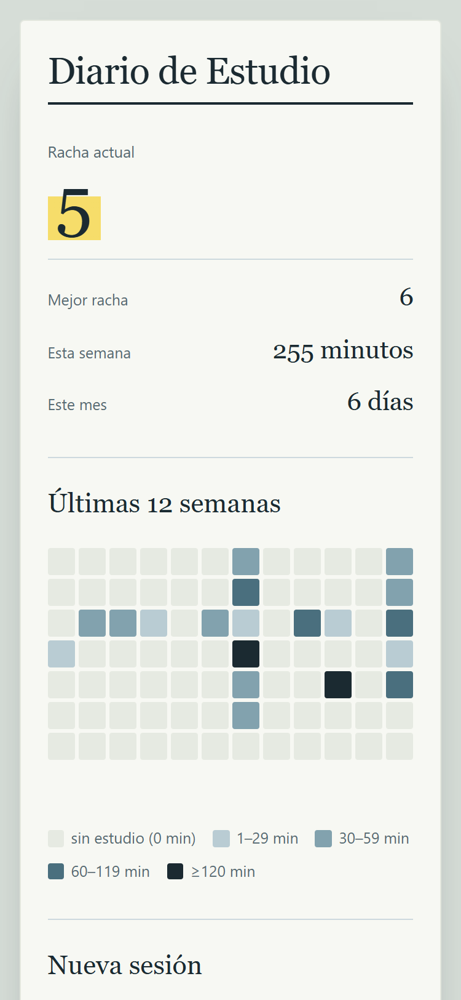

# Diario de Estudio

Web estática desarrollada con opencode para registrar tus sesiones de estudio y ver tu constancia de un vistazo: racha actual, mejor racha, minutos de la semana, días del mes y un mapa de calor de las últimas 12 semanas.

## Funcionalidades

- **Registrar sesiones**: fecha, tema y minutos.
- **Racha actual** y **mejor racha** (el tramo más largo del historial).
- **Minutos de la semana** en curso (semana natural de lunes a domingo).
- **Días estudiados del mes** en curso.
- **Mapa de calor de constancia**: las últimas 12 semanas, un día por celda y cinco niveles de intensidad según los minutos del día.
- **Persistencia local**: los datos se guardan en el `localStorage` del navegador.
- **Fechas locales**: todo se calcula en la zona horaria del usuario.

## Cómo usarlo

1. Clona o descarga el repositorio.
2. Abre `index.html` en el navegador (doble clic).
3. Añade tu primera sesión.

## Estructura del proyecto

| Archivo         | Qué contiene                                                |
| --------------- | ----------------------------------------------------------- |
| `index.html`    | Estructura de la página                                     |
| `styles.css`    | Estilos (tema "cuaderno de estudio")                        |
| `app.js`        | Interfaz: formulario, lista, estadísticas y mapa            |
| `logic.js`      | Lógica pura (fechas, rachas, estadísticas y mapa de calor)  |
| `logic.test.js` | Tests de la lógica con el runner de Node                    |
| `assets/`       | Capturas de pantalla para el README                         |
| `docs/`         | Constitución del proyecto                                   |
| `specs/`        | Especificaciones, planes y tareas (Spec-Driven Development) |

## Tecnologías

- HTML5, CSS3 y JavaScript (sin frameworks).
- `localStorage` para guardar los datos.
- Node solo para ejecutar los tests.

## Autoría y créditos

- Proyecto de práctica del curso **[Curso de Desarrollo con IA: el Nuevo Programador](https://thebigschool.com/sp/curso-desarrollo-ia-nuevo-programador-eg/)** de **MoureDev** (The Big School).

## Licencia

Distribuido bajo la licencia [Apache 2.0](LICENSE).
